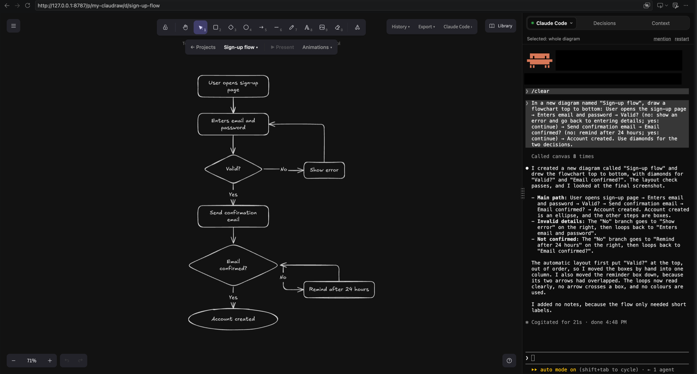
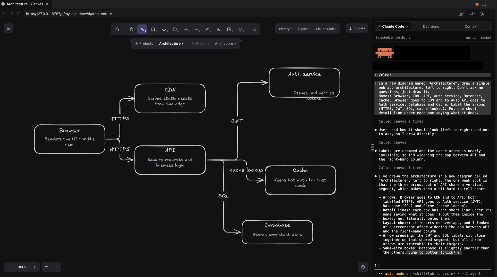
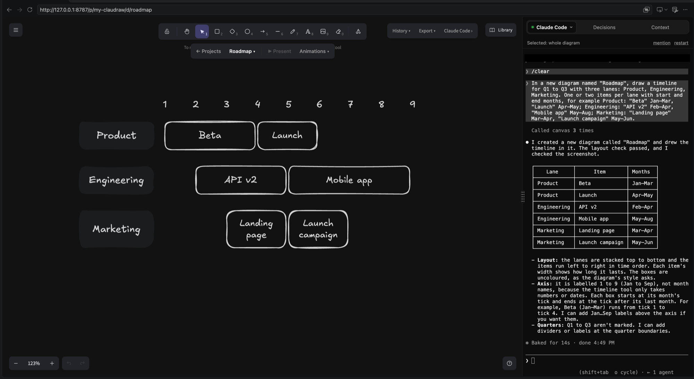
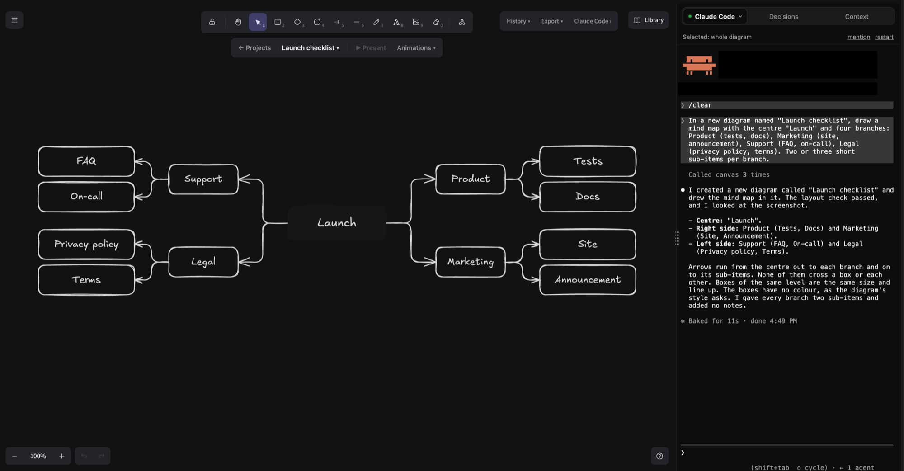
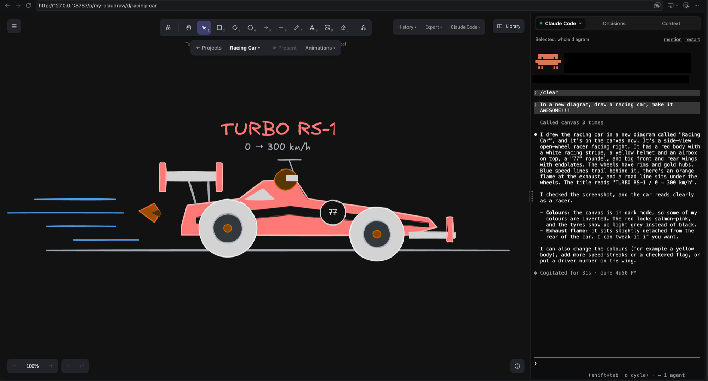
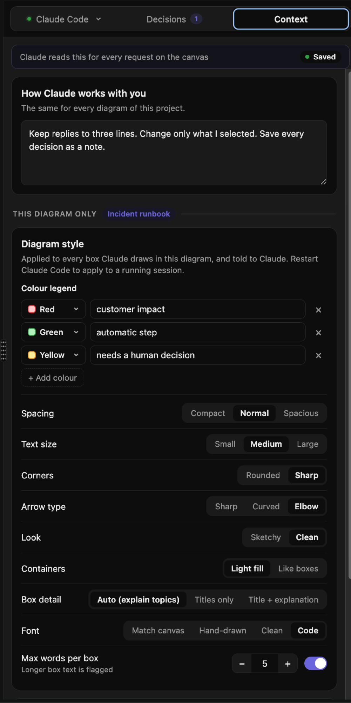
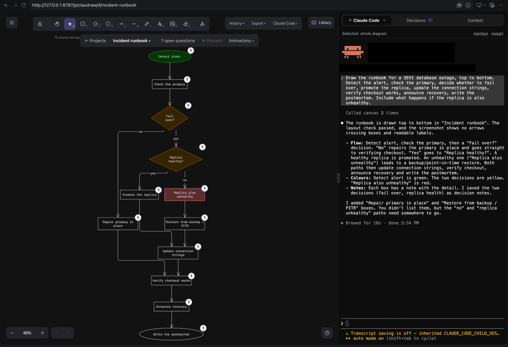
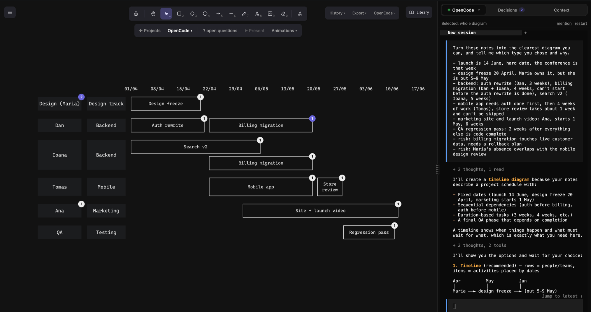
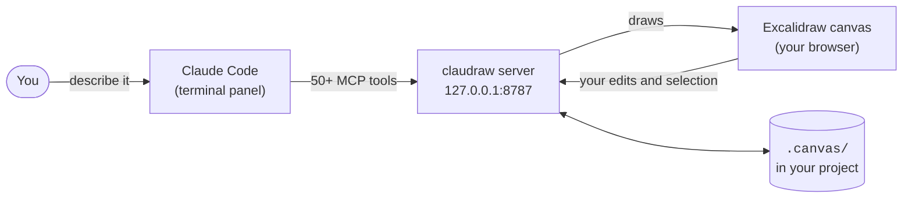

<div align="center">


# claudraw

### Talk to your diagrams.

**An Excalidraw canvas with Claude Code built in.** Describe what you want, and Claude draws it as real, editable shapes,
checks its own layout, and keeps everything as plain files in your repo.


</div>



> The prompt behind that picture, typed into the side panel: *"In a new diagram named "Sign-up flow", draw a flowchart top to
> bottom: User opens the sign-up page → Enters email and password → Valid? (no: show an error and go back to entering
> details; yes: continue) → Send confirmation email → Email confirmed? (no: remind after 24 hours; yes: continue) → Account
> created. Use diamonds for the two decisions."* About 20 seconds, 8 tool calls, no clicking.

## Why you will like it

- **Diagrams in the time it takes to describe them.** Architecture, flows, timelines, sequences, mind maps, kanban boards,
  charts, even free-form drawings. Say what you mean in plain words.
- **It picks the right kind of diagram.** A built-in recommender reads your text and chooses between a timeline, a flow,
  an architecture, columns, a table, a tree and more, so a schedule does not end up as a tangle of arrows.
- **It checks its own work.** After drawing, Claude runs a layout check (overlaps, text that does not fit, arrows crossing
  boxes), fixes what it finds, takes a screenshot and looks at it. You see that happen in the terminal.
- **You stay in control.** It is a real Excalidraw canvas: grab the pen, move a box, restyle it. Select a few boxes and Claude
  works on just those. Changes are tracked by revision, so a stale write can be refused instead of overwriting what you just moved.
- **Your diagrams live in your repo.** Everything is plain files in a `.canvas/` folder next to your code: commit them, diff
  them, share them. Export to `.excalidraw`, PNG or SVG whenever you like.
- **Local and private.** The server listens on `127.0.0.1` only. No account, no cloud. The one network call it makes by
  itself is an update check against this GitHub repo, and `CANVAS_NO_UPDATE_CHECK=1` turns it off.

## Quick start

```sh
npm i -g git+https://github.com/andreivasilache/claudraw.git   # Node 20+
cd ~/projects/my-app
canvas init && canvas                                           # then open http://127.0.0.1:8787
```

Open your project, and type into the Claude Code panel on the right. Details and options are in [Install](#install) below.

## What you can make

| | |
|---|---|
| **Flows and architecture** | Flowcharts with decisions and loops (from Mermaid or built directly), architecture diagrams with groups and labelled arrows, trees, cycles |
| **Time and people** | Timelines with lanes, sequence diagrams, kanban boards, tables, 2×2 quadrants |
| **Ideas** | Mind maps with details inside the boxes, sticky-note boards |
| **Numbers** | Column, bar, line, area, pie, donut, scatter, funnel and waterfall charts |
| **Anything else** | Free-form drawing from lines, shapes and text. See the racing car below. |

And around the drawing:

- **Notes on any box**, such as examples, sources, facts, decisions and open questions. Claude reads them before touching a
  box and saves what you settle in conversation, so the reasoning is still there next week.
- **Decisions.** Notes marked as a decision or a question carry a status (open, decided, reversed). The **Decisions** tab
  collects them across the diagram, so you can see what is still open at a glance. Reversing a decision keeps the old
  reasoning in the log instead of deleting it. Ask for "export the decisions" and Claude writes a `DECISIONS.md` in your
  project root, grouped into open, decided and reversed.
- **History and undo.** Every change Claude makes is saved first; step back from the History menu or by asking for an undo.
- **Several diagrams per project**, and several projects on one server and one port.
- **Per-diagram style and rules** in the [**Context** tab](#make-it-yours-the-context-tab): look (sketchy or clean), corners, font,
  a colour legend, a word limit per box, and plain-words rules for how Claude works with you.
- **Animations and Present mode.** Turn a diagram into a presentation: each step reveals some boxes (they fade in), arrows
  are drawn from start to end with their label arriving last, and earlier steps dim so the new one stands out. Steps can carry
  a caption. Build them in the **Steps** panel or just ask Claude ("make a presentation that reveals this layer by layer");
  a diagram can hold several, saved with it in `.canvas/animation.json`. Click **Present** and advance one step per click.
- **Export** as `.excalidraw` (opens on excalidraw.com), PNG or SVG, from the Export menu.
- **Your choice of agent.** Claude Code by default, or [OpenCode](#bring-your-own-model-opencode) to drive other models,
  including local and self-hosted ones. How well that works depends on the model.

## See it work

Every picture below is one prompt, typed into the side panel, with the result straight from the canvas.

### An architecture, with a detail line in every box



> *In a new diagram named "Architecture", draw a simple web app architecture, left to right. Don't ask me questions, just
> draw it. Boxes: Browser, CDN, API, Auth service, Database, Cache. Browser goes to CDN and to API; API goes to Auth service,
> Database and Cache. Label the arrows (HTTPS, JWT, SQL, cache lookup). Put one short detail line under each box saying what
> it does.*

### A timeline with lanes, sized by duration



> *In a new diagram named "Roadmap", draw a timeline for Q1 to Q3 with three lanes: Product, Engineering, Marketing. One or
> two items per lane with start and end months, for example Product: "Beta" Jan–Mar, "Launch" Apr–May; Engineering: "API v2"
> Feb–Apr, "Mobile app" May–Aug; Marketing: "Landing page" Mar–Apr, "Launch campaign" May–Jun.*

### A mind map



> *In a new diagram named "Launch checklist", draw a mind map with the centre "Launch" and four branches: Product (tests,
> docs), Marketing (site, announcement), Support (FAQ, on-call), Legal (privacy policy, terms). Two or three short sub-items
> per branch.*

### And when you just want something fun



> *In a new diagram, draw a racing car, make it AWESOME!!!*

That is not a template. Claude composed the car, the speed lines and the title from shapes, then looked at its own
screenshot and noted that the red comes out salmon-pink in dark mode.

## Make it yours: the Context tab

Claude reads the **Context** tab on every request, so a diagram follows *your* conventions without you repeating them. It has
three layers:

- **How Claude works with you**: standing rules in plain words, shared by every diagram in the project ("keep replies short",
  "change only what I selected", "save every decision as a note"). They are advice to the agent, so how closely they are
  followed depends on the model.
- **Diagram style**: a colour legend, look (sketchy or clean), corners, arrow type, font, spacing, text size, how much to
  explain inside a box, and a word limit per box. The drawing engine applies these itself.
- **About this diagram**: what it is for, who reads it, and the terms the boxes do not spell out.

<table>
<tr>
<td width="30%"></td>
<td></td>
</tr>
</table>

The setup behind that picture, in a new diagram called "Incident runbook":

- **Colour legend:** red = customer impact, green = automatic step, yellow = needs a human decision.
- **Style:** sharp corners, clean look, elbow arrows, code font, at most 5 words per box.
- **About this diagram:** *Runbook for the on-call engineer during a database outage. Read at 3 a.m., so it must be
  scannable. "SEV1" means customers cannot check out. "Failover" means promoting the replica to primary.*

Then one prompt that never mentions colour:

> *Draw the runbook for a SEV1 database outage, top to bottom. Detect the alert, check the primary, decide whether to fail
> over, promote the replica, update the connection strings, verify checkout works, announce recovery, write the postmortem.
> Include what happens if the replica is also unhealthy.*

Claude coloured the start green, both decisions yellow and the "Replica also unhealthy" box red, from the legend alone, kept
every box under five words, and asked no questions. Change the style in the tab and ask for a redraw to see the same content
in another look.

## Bring your own model: OpenCode

claudraw is not tied to one model. The panel can run [OpenCode](https://opencode.ai), an open-source terminal coding agent
that talks to many model providers, including local and self-hosted ones. Pick it from the agent dropdown at the top of the
panel (**Claude Code ▾ → OpenCode**), or choose **Settings…** in the same dropdown to add entries, for example one per model.
Install OpenCode separately and configure its providers and keys in its own config; claudraw starts it for you, connects it to
the canvas tools and hands it the same working rules.

**Why you might want it**

- **Choose your model.** Use whatever OpenCode supports, including models your company has approved.
- **Keep it local.** With a local or self-hosted model, your prompts and diagrams go only to the provider you configured. The
  canvas itself already runs on your machine and offline.
- **Control cost.** Draw routine diagrams with a cheaper or local model, and keep a stronger one for hard ones.
- **Compare.** Run the same prompt with two models and look at the result side by side.

**Be realistic:** drawing means calling many tools with exact arguments, and that is where models differ most. claudraw adds
guardrails for OpenCode: when the diagram type is not already clear, the agent must show two or three options with a sketch and
wait for your choice, tool results return ids, common argument mistakes are corrected, and a reminder follows each drawing. But **the result depends on the
model's performance.** Strong tool-calling models do well; small ones can pick the wrong arguments, skip steps or need a retry.
Claude Code is the reference experience, so if something fails with OpenCode, try a simpler prompt or a stronger model first,
and [open an issue](https://github.com/andreivasilache/claudraw/issues) with what you saw.



<details>
<summary>The prompt used above: messy meeting notes, where the agent has to choose the diagram itself</summary>

```
Turn these notes into the clearest diagram you can, and tell me which type you chose and why.

- launch is 14 June, hard date, the conference is that week
- design freeze 20 April, Maria owns it, but she is out 5-9 May
- backend: auth rewrite (Dan, 3 weeks), billing migration (Dan + Ioana, 4 weeks, can't start before the auth rewrite is done), search v2 (Ioana, 5 weeks)
- mobile app needs auth done first, then 4 weeks of work (Tomas), store review takes about 1 week and can't be skipped
- marketing site and launch video: Ana, starts 1 May, 6 weeks
- QA regression pass: 2 weeks after everything else is code complete
- risk: billing migration touches live customer data, needs a rollback plan
- risk: Maria's absence overlaps with the mobile design review
```

</details>

## How it works



claudraw is three things in one process: an **MCP server** that gives Claude drawing tools, a **web page** (Excalidraw, notes,
history, a terminal), and a **terminal** running the agent you choose. `canvas init` registers the server in your project's
`.mcp.json`, so Claude Code finds the tools by itself. The rules Claude follows (selection is the scope, plan before drawing,
save notes) travel with the server, so they update when you update the tool.

## Try these next

Once you have a diagram on the canvas:

- *Select three boxes, then:* "Recolour just the selected boxes green and add a note on each saying why we chose it."
- "Turn this flowchart into a timeline."
- "Add a note on the Auth service with three open questions, mark them as open."
- "Make a presentation that reveals this architecture layer by layer, with a caption on each step."
- "Walk through this sequence diagram as an animation, one message per step, with a caption on why it happens."
- "Which decisions are still open? Export them to DECISIONS.md."
- "Undo that." (or open **History** and pick a point)
- "Export it as SVG."

## Status

claudraw is young (v1.0.0) and has been **tested on macOS only**. Small models can still stumble on the stricter tools; the
[roadmap](ROADMAP.md) lists what is known to be unfinished. Bug reports and ideas are welcome:
[open an issue](https://github.com/andreivasilache/claudraw/issues).

---

## Install

Needs **Node 20+**, **git**, and the agent you want in the side panel (for example [Claude Code](https://claude.com/claude-code)).

```sh
npm i -g git+https://github.com/andreivasilache/claudraw.git
canvas --version
```

To pin a release, add its tag: `...claudraw.git#v1.0.0` (see the [tags](https://github.com/andreivasilache/claudraw/tags)).
The UI is prebuilt and committed (`dist/`), so nothing is compiled for the UI during the install.

> **Tested on macOS only.** It is written to be portable, but Linux and Windows have not been tried, so expect rough edges
> there and please [open an issue](https://github.com/andreivasilache/claudraw/issues) if something breaks.
> `node-pty` (the terminal) ships prebuilt binaries for macOS and Windows; on Linux npm compiles it during the install, which
> needs Python 3, `make` and a C++ compiler (`build-essential` on Debian/Ubuntu).

claudraw is a local tool: it listens on `127.0.0.1` only and runs a shell in the browser, so never expose its port. See
[SECURITY.md](SECURITY.md).

## Use it in a project

```sh
cd ~/projects/my-app
canvas init          # once per project
canvas               # start the server (http://127.0.0.1:8787)
```

`canvas init [dir]` is safe to run again; it never overwrites existing data:

1. creates `.canvas/` with the files that are missing (empty diagram, context, rules, diagram list), in the current format;
2. adds or updates the `canvas` entry in `.mcp.json` (`type: http`, `http://127.0.0.1:<port>/p/<id>/mcp`), leaving other servers alone;
3. adds a short section to `CLAUDE.md` between `<!-- canvas:start -->` and `<!-- canvas:end -->` (the file is created if needed; text outside the markers is never touched);
4. registers the project in `~/.config/canvas/projects.json`.

`canvas` serves the project of the current folder (it must have been set up with `canvas init`). If canvas is already running
on the port, for example from another project, the new `canvas` hands its project to that server and exits, so several
projects share one server and one port. Open the project list at http://127.0.0.1:8787 (the project itself is at `/p/<id>`).
The `canvas` MCP server only exists while `canvas` is running.

A run lists only the projects it was started for or that were added to it since; the registry may hold more.
`canvas --all` shows every project in the registry.

## Commands

| | |
|---|---|
| `canvas [projectDir] [--all] [--port N] [--prod]` | Start the server for `projectDir` (default: the current folder, which needs a `.canvas/`), or add it to the canvas already running on the port. `--all` shows every registered project. `--prod` serves the built UI from `dist/` instead of a Vite dev server. Default port 8787 (`CANVAS_PORT`). |
| `canvas init [dir] [--port N]` | Prepare a project (see above). `--port` is what goes into `.mcp.json`; an existing port there is kept. |
| `canvas init [dir] --update` | Rewrite only what is between the markers in `CLAUDE.md` and the canvas fields of `.mcp.json`. Does not touch `.canvas/`. |
| `canvas --version` | The installed version. |

A project is added only with `canvas <dir>`, `canvas init`, or the "Add project" form on the list page.

## Update

```sh
npm i -g git+https://github.com/andreivasilache/claudraw.git   # or ...claudraw.git#vX.Y.Z
# restart canvas, then in each project that uses it:
canvas init --update                                  # refresh the CLAUDE.md section and .mcp.json
```

The project list shows the installed version and, when the repo has a newer tag, which one. This is the only network call
claudraw makes by itself: a `git ls-remote --tags` against this GitHub repo, in the background with a short timeout, silent on
any error, nothing about you or your projects is sent. `CANVAS_NO_UPDATE_CHECK=1` turns it off.

The rules Claude follows (selection scope, notes, how to draw) are the MCP server's own instructions and `read_guide`, so they
update with the tool; the `CLAUDE.md` section only points to them.

## Data and compatibility

Everything is in `.canvas/` (the diagram, `notes.json`, `context.json`, `rules.json`, `diagrams.json`, `generated.json`,
`animation.json`, `history/`, and `diagrams/<id>/` for other diagrams). Every data file carries a `version` (`canvasVersion` in
`diagram.excalidraw`, which has its own Excalidraw `version`); a file without one is version 0.

- **Older project, newer tool:** on first open the missing migrations run (`server/migrate.ts`). Before that, each file that
  changes is copied to `.canvas/.backup-<old version>/`, and each is then rewritten atomically. Running it again does nothing.
- **Newer project, older tool:** the server does not write to it and shows "This project uses data format vN … Update
  claudraw". Update the tool.
- Package versions are semver. A change to the data format that older versions cannot read is a **major** version
  (see `CHANGELOG.md`).

Settings live outside the projects: `~/.config/canvas/projects.json` (the list) and `settings.json` (the agents the panel can
run, with API keys; mode 600). `CANVAS_PROJECTS` and `CANVAS_SETTINGS` point to other files.

## Develop and release

```sh
npm install
npm start -- ../some-project     # server with the Vite dev server
npm run typecheck && npm test
```

`dist/` and `public/fonts/` are committed on purpose: `npm i -g git+https://…` does not run a build that needs the dev
dependencies (a `prepare` script failed in that flow), and a global install should not have to compile anything. `npm version
<patch|minor|major>` rebuilds `dist/` (`build:ui`), adds it to the version commit and creates the tag; a test fails when `dist/` is
stale. Then:

```sh
git push && git push --tags
```

Do not name a script `build`: `npm i -g` from git then tries to run it before the dependencies are installed.

## Contributing, security, license

See [CONTRIBUTING.md](CONTRIBUTING.md), [SECURITY.md](SECURITY.md) and [ROADMAP.md](ROADMAP.md) (what is planned and known to be
unfinished). MIT licensed, see [LICENSE](LICENSE); bundled fonts and libraries keep their own licenses,
see [THIRD_PARTY_NOTICES.md](THIRD_PARTY_NOTICES.md).

claudraw is an independent, community project. It is not affiliated with, endorsed by or sponsored by Anthropic. "Claude" and
"Claude Code" are trademarks of Anthropic, PBC; the logo only alludes to them to show what the tool works with.
